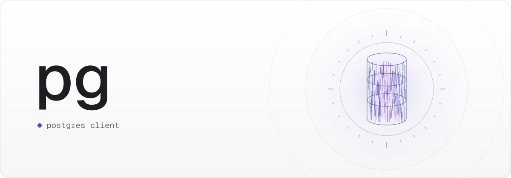
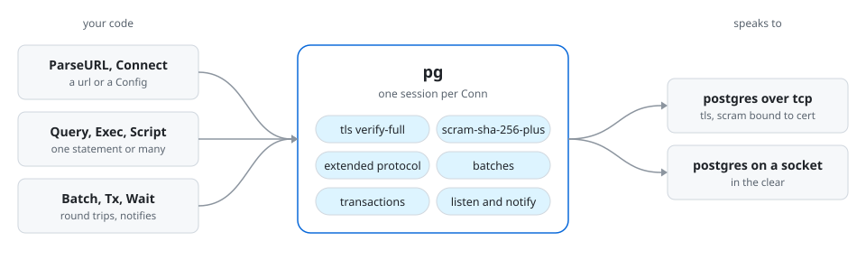
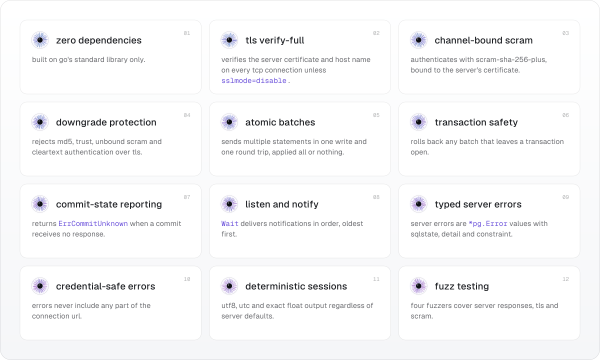

<picture>
  <source media="(prefers-color-scheme: dark)" srcset="docs/assets/hero-dark.svg">
  
</picture>

a postgres client in go, with tls verify-full, scram-sha-256-plus and one-trip batches.

## quick start

```sh
go get github.com/haydencooper/pg
```

```go
cfg, err := pg.ParseURL("postgres://app@db.example/app?sslrootcert=/etc/ssl/db-ca.pem")
conn, err := pg.Connect(ctx, cfg)
res, err := conn.Query(ctx, "SELECT name FROM projects WHERE id = $1", id)
```

needs go 1.23 or newer and nothing else. [connecting](docs/connecting.md) covers the url, tls and logging in.

## how it fits

<picture>
  <source media="(prefers-color-scheme: dark)" srcset="docs/assets/flow-dark.svg">
  
</picture>

## features

<picture>
  <source media="(prefers-color-scheme: dark)" srcset="docs/assets/features-dark.svg">
  
</picture>

<details>
<summary>features as text</summary>

<table>
  <tr>
    <td width="33%" valign="top"><b>zero dependencies</b><br><sub>built on go's standard library only.</sub></td>
    <td width="33%" valign="top"><b>tls verify-full</b><br><sub>verifies the server certificate and host name on every tcp connection unless <code>sslmode=disable</code>.</sub></td>
    <td width="33%" valign="top"><b>channel-bound scram</b><br><sub>authenticates with scram-sha-256-plus, bound to the server's certificate.</sub></td>
  </tr>
  <tr>
    <td valign="top"><b>downgrade protection</b><br><sub>rejects md5, trust, unbound scram and cleartext authentication over tls.</sub></td>
    <td valign="top"><b>atomic batches</b><br><sub>sends multiple statements in one write and one round trip, applied all or nothing.</sub></td>
    <td valign="top"><b>transaction safety</b><br><sub>rolls back any batch that leaves a transaction open.</sub></td>
  </tr>
  <tr>
    <td valign="top"><b>commit-state reporting</b><br><sub>returns <code>ErrCommitUnknown</code> when a commit receives no response.</sub></td>
    <td valign="top"><b>listen and notify</b><br><sub><code>Wait</code> delivers notifications in order, oldest first.</sub></td>
    <td valign="top"><b>typed server errors</b><br><sub>server errors are <code>*pg.Error</code> values with sqlstate, detail and constraint.</sub></td>
  </tr>
  <tr>
    <td valign="top"><b>credential-safe errors</b><br><sub>errors never include any part of the connection url.</sub></td>
    <td valign="top"><b>deterministic sessions</b><br><sub>utf8, utc and exact float output regardless of server defaults.</sub></td>
    <td valign="top"><b>fuzz testing</b><br><sub>four fuzzers cover server responses, tls and scram.</sub></td>
  </tr>
</table>

</details>

## api

| | |
| :-- | :-- |
| `pg.ParseURL(url)` | a `Config` from a `postgres://` url |
| `pg.Connect(ctx, cfg)` | dial, speak tls and log in |
| `conn.Query(ctx, sql, args...)` | one statement, every row read |
| `conn.Batch(ctx, statements...)` | many statements in one round trip |
| `conn.Tx(ctx, work)` | work in a transaction, committed or rolled back |
| `conn.Wait(ctx)` | the next notification |

the rest is in [queries](docs/queries.md).

## guides

| guide | covers |
| :-- | :-- |
| [connecting](docs/connecting.md) | the url, a config, tls, logging in and session settings |
| [queries](docs/queries.md) | queries, values, scripts, transactions, notifications and errors |
| [batches](docs/batches.md) | what a batch guarantees and how it fails |
| [testing](docs/testing.md) | unit, integration and fuzz tests, and ci |
